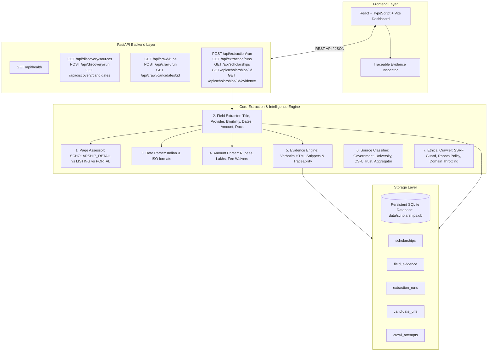

# System Architecture — Scholarship Intelligence Crawler for Indian Students

## 1. System Overview

The **Scholarship Intelligence Crawler** is an automated, reliable system designed to discover, crawl, extract, verify, and track the lifecycle of authentic scholarship opportunities for Indian students across government, state, university, corporate CSR, and philanthropic trust portals.

---

## 2. Extraction & Field-Level Evidence Pipeline (Phase 3)

### A. End-to-End Extraction Flow
`Discovered candidate → Crawled HTML → Page assessment → Field extraction → Evidence attachment → Schema validation → Persistent database record`

1. **Page Assessment (`PageAssessor`)**:
   - Classifies page structure before extraction:
     - `SCHOLARSHIP_DETAIL`: Individual scholarship page containing title and specific scheme attributes.
     - `SCHOLARSHIP_LISTING`: Multi-scholarship directory or portal index.
     - `APPLICATION_PORTAL`: User login / OTR registration / password screens (rejected from becoming scholarship records).
     - `GENERIC_PAGE`: Generic portal homepages or about pages.
     - `INSUFFICIENT_EVIDENCE`: Pages lacking minimum verifiable criteria.
     - `FETCH_FAILED`: Empty, blocked, or network failure pages.

2. **Deterministic Field Extraction (`FieldExtractor`)**:
   - **Scholarship Name**: Extracted from `<h1>`, `<h2>`, or `<title>` tag with site brand noise stripped.
   - **Provider Organization**: Identified against verified authority dictionaries (e.g. "Ministry of Social Justice and Empowerment", "AICTE", "UGC", "Reliance Foundation").
   - **Financial Benefit**: RegEx parsing for currency amounts (`₹50,000`, `Rs. 50,000`, `INR 2.5 Lakhs`, `per annum`, `monthly stipend`) and in-kind benefits (`100% Tuition Fee Waiver`).
   - **Dates & Deadlines**: Parses Indian formats (`DD/MM/YYYY`, `DD-MM-YYYY`, `DD Month YYYY`) with contextual boundary matching.
   - **Eligibility & Academic Criteria**: Extracts education levels, income thresholds (e.g. `< ₹2.5 Lakhs`), gender specifications, and category reservations (`SC`, `ST`, `OBC`, `PwD`).
   - **Application URLs**: Safely extracted and SSRF-checked.
   - **Anti-Hallucination Policy**: Fields with no supporting evidence remain strictly `None`/null and are displayed as *"Not specified"* in the user interface.

3. **Field-Level Traceable Evidence (`field_evidence` table)**:
   - For every extracted attribute, a distinct `FieldEvidence` row is persisted with:
     - Exact `extracted_value`
     - Verbatim `evidence_text` snippet from source HTML
     - Source URL and page title
     - SHA-256 `content_hash` of the fetched page
     - DOM selector or element tag path
     - Validation status (`VALID`)
   - Allows full audit trace:
     `Scholarship record → Extracted field → Evidence record → Original official URL → Content Hash`.

---

## 3. Database Schema (`backend/app/db/models.py`)

- `scholarships`: Structured opportunities with `stable_id`, `name`, `provider`, `official_source_url`, `amount_benefit`, `closing_date`, `course_level`, `income_criteria`, `lifecycle_status`, `page_type`, and `content_hash`.
- `field_evidence`: Verbatim snippets linked to individual fields and parent scholarship records.
- `extraction_runs`: Audit history of extraction sessions with scanned, extracted, insufficient, and failure counts.
- `candidate_urls`: Discovered candidate links and relevance scores.
- `crawl_attempts`: HTTP fetch results with SHA-256 content hashes and raw HTML snapshots.
- `seed_sources`: Configured authentic portal entrypoints.

---

## 4. Phased Implementation Roadmap

- [x] **Phase 1**: Project Foundation, SQLite database, FastAPI backend, React/Vite/TS dashboard, configuration, test suite.
- [x] **Phase 2**: Real Scholarship Discovery, Ethical HTTP Crawling, SSRF Protection, Robots.txt, Source Classifier, Candidate Extraction, and Crawl History Audit Trail.
- [x] **Phase 3**: Deterministic Scholarship Field Extraction (Title, Provider, Eligibility, Award Amount, Deadline, Official URL, and Field-Level Verbatim Evidence).
- [ ] **Phase 4**: Deterministic Confidence & Verification Engine (Strict ≥95% confidence threshold for VERIFIED status).
- [ ] **Phase 5**: Lifecycle Change Detection (Active, Stale, Expired), Diff Auditing, Full Interactive Dashboard, and Benchmark Evaluation.
