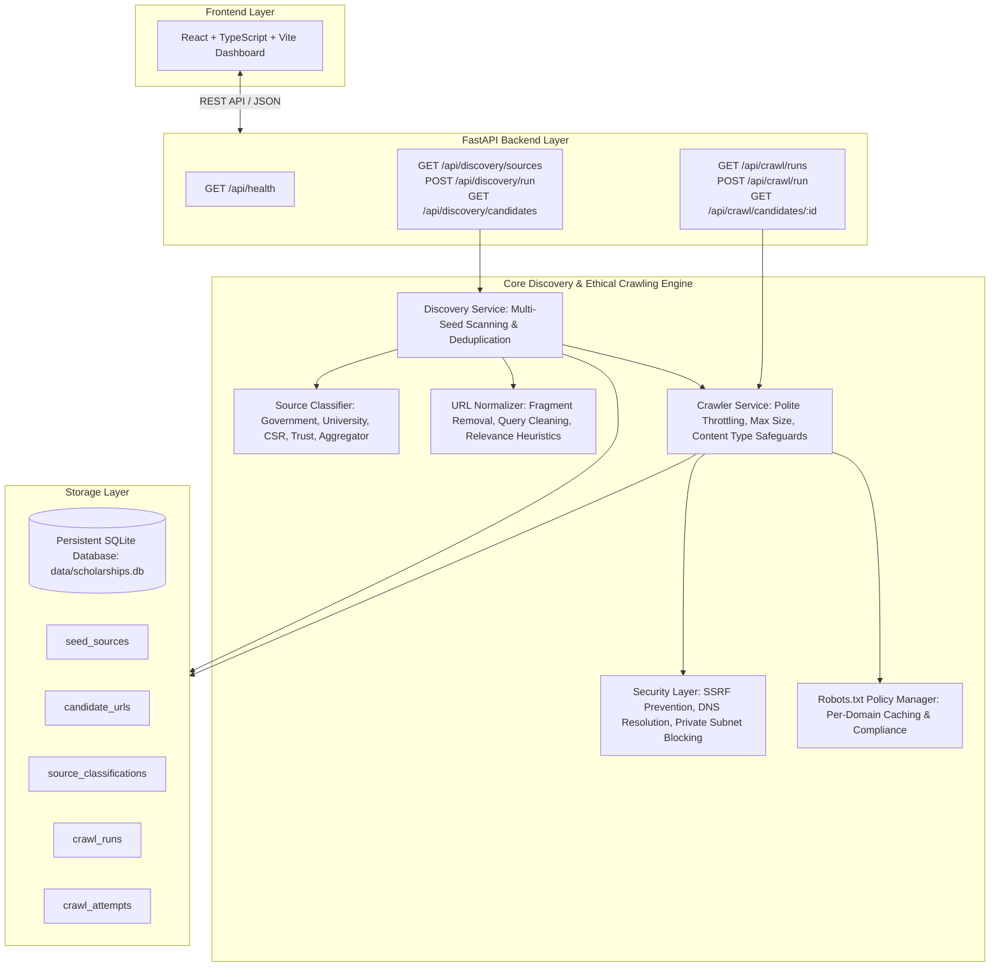

# System Architecture — Scholarship Intelligence Crawler for Indian Students

## 1. System Overview

The **Scholarship Intelligence Crawler** is an automated, reliable system designed to discover, crawl, extract, verify, and track the lifecycle of authentic scholarship opportunities for Indian students across government, state, university, corporate CSR, and philanthropic trust portals.

---

## 2. Implemented Architecture (Phases 1 & 2)

### A. Discovery Engine (`backend/app/services/discovery/`)
- **`url_normalizer.py`**:
  - Resolves relative URLs to canonical absolute links.
  - Strips URL fragments (`#...`).
  - Strips ad/tracking query parameters (`utm_*`, `ref`, `fbclid`, `gclid`, etc.) while retaining functional query arguments.
  - Collapses redundant slashes and standardizes trailing slashes.
  - Filters out binary file extensions (`.pdf`, `.docx`, `.zip`, `.jpg`, etc.).
  - Calculates scholarship relevance heuristics [0.0 - 1.0] by inspecting URL slugs, anchor text, and context against weighted keywords (`scholarship`, `fellowship`, `stipend`, `yojana`, `medhabruti`, `vidyasaarathi`, `post-matric`, `pre-matric`, `eligibility`, `apply`).
- **`discovery_service.py`**:
  - Extracts candidate links from HTML pages via BeautifulSoup.
  - Implements database-backed deduplication on `normalized_url`.
  - Records discovery method (`SEED_PORTAL`, `INTERNAL_LINK`, `AGGREGATOR_LINK`), source URL, relevance score, and classification.

### B. Ethical Crawler & Security Layer (`backend/app/services/crawling/`)
- **`security.py`**:
  - **SSRF Prevention**: Validates URL scheme (strictly `http` and `https`).
  - Resolves domain hostnames via DNS and checks all resulting IP addresses against restricted CIDR blocks:
    - Loopback (`127.0.0.0/8`, `::1/128`)
    - Private networks (`10.0.0.0/8`, `172.16.0.0/12`, `192.168.0.0/16`, `fc00::/7`)
    - Link-local and cloud metadata IPs (`169.254.0.0/16`, `169.254.169.254`, `metadata.google.internal`)
    - Carrier-grade NAT (`100.64.0.0/10`)
    - Multicast & broadcast (`224.0.0.0/4`, `255.255.255.255`)
- **`robots.py`**:
  - Per-domain caching and parsing of `robots.txt` using `urllib.robotparser.RobotFileParser`.
- **`http_client.py`**:
  - Configurable timeouts (default 15s) and User-Agent identification.
  - Exponential backoff retries on transient errors.
  - Per-domain rate limiting (minimum 2.0s delay between requests to same domain).
  - Manual step-by-step redirect inspection ensuring redirect destinations do not bypass SSRF checks.
  - Response size safeguards (aborts streaming if body exceeds 5MB).
  - Content-Type enforcement (accepts only `text/html`, `application/xhtml+xml`).
  - SHA-256 content hashing of fetched HTML for audit trail integrity.
- **`crawler_service.py`**:
  - Orchestrates crawls on candidate URLs.
  - Records detailed `CrawlAttempt` logs (HTTP status, response time ms, content length, SHA-256 hash, error reasons).
  - Automatically transitions candidates from `DISCOVERED`/`QUEUED` to `CRAWLED` or `FAILED`.
  - Recursively extracts secondary links from successfully crawled pages.

### C. Source Classification Engine (`backend/app/services/verification/source_classifier.py`)
Deterministic classification distinguishing:
1. **`CENTRAL_GOVERNMENT`**: Apex government domains (`.gov.in`, `.nic.in`) and statutory bodies (`ugc.gov.in`, `aicte-india.org`).
2. **`STATE_GOVERNMENT`**: State portal subdomains (e.g., `*.karnataka.gov.in`, `*.maharashtra.gov.in`, `*.up.gov.in`).
3. **`UNIVERSITY`**: Recognized university domains (`.ac.in`, `.edu.in`).
4. **`CORPORATE_CSR`**: Verified corporate CSR programs (`reliancefoundation.org`, `tatatrusts.org`, `ongcfoundation.org`, `infosys.org`, `hdfcbank.com`).
5. **`TRUST_FOUNDATION`**: Registered philanthropic trusts (`kcmet.org`, `nsfoundation.co.in`, `sitaramjindalfoundation.org`, `inlaksfoundation.org`).
6. **`AGGREGATOR`**: Scholarship listings and discovery feeds (`buddy4study.com`, `scholarshipsinindia.com`); designated as discovery feeds requiring primary source resolution.
7. **`UNKNOWN`**: Unverified domains requiring manual review.

Every classification retains an explicit explainable `classification_reason`, `is_official` boolean flag, and `trust_score`.

---

## 3. Data Models (`backend/app/db/models.py`)

- `SeedSource`: Configured portal entrypoints.
- `CandidateURL`: Discovered candidate URLs with relevance score, status, and discovery source.
- `SourceClassification`: Domain classifications, trust scores, and reasons.
- `CrawlRun`: Audit session logging for discovery and crawl runs.
- `CrawlAttempt`: Individual HTTP attempt record with timing, status, content hash, and error diagnostics.
- `SystemInfo`: Migration and system configuration tracking.

---

## 4. Phased Implementation Roadmap

- [x] **Phase 1**: Project Foundation, SQLite database, FastAPI backend, React/Vite/TS dashboard, configuration, test suite.
- [x] **Phase 2**: Real Scholarship Discovery, Ethical HTTP Crawling, SSRF Protection, Robots.txt, Source Classifier, Candidate Extraction, and Crawl History Audit Trail.
- [ ] **Phase 3**: Deterministic Scholarship Field Extraction (Title, Provider, Eligibility, Award Amount, Deadline, Official URL, and Field-Level Verbatim Evidence).
- [ ] **Phase 4**: Deterministic Confidence & Verification Engine (Strict ≥95% confidence threshold for VERIFIED status).
- [ ] **Phase 5**: Lifecycle Change Detection (Active, Stale, Expired), Diff Auditing, Full Interactive Dashboard, and Benchmark Evaluation.
