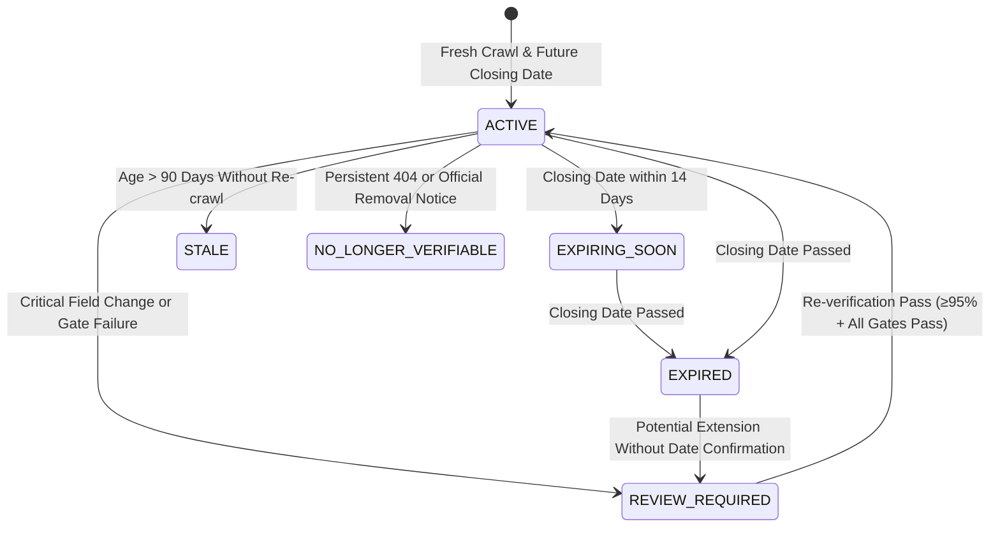

# System Architecture — Scholarship Intelligence Crawler for Indian Students

## 1. System Overview

The **Scholarship Intelligence Crawler** is an automated, reliable system designed to discover, crawl, extract, verify, and track the lifecycle of authentic scholarship opportunities for Indian students across government, state, university, corporate CSR, and philanthropic trust portals.

```mermaid
graph TD
    subgraph UI [Frontend Layer]
        Dashboard[React + TypeScript + Vite Dashboard]
        SchedulerBanner[Scheduler Controls & Progress Banner]
        ChangesTab[Field-Level Change History Audit]
        EvidenceModal[Traceable Evidence Inspector]
        VerificationModal[Verification & Gate Audit Modal]
        ChangesModal[Scholarship Timeline Diff Modal]
    end

    subgraph API [FastAPI Backend Layer]
        HealthRoute[GET /api/health]
        SchedulerRoutes[POST /api/scheduler/start<br/>POST /api/scheduler/stop<br/>GET /api/scheduler/status]
        ChangesRoutes[GET /api/changes/recent<br/>GET /api/scholarships/:id/changes]
        DiscoveryRoutes[GET /api/discovery/sources<br/>POST /api/discovery/run<br/>GET /api/discovery/candidates]
        CrawlRoutes[GET /api/crawl/runs<br/>POST /api/crawl/run<br/>GET /api/crawl/status<br/>GET /api/crawl/candidates/:id]
        ExtractionRoutes[POST /api/extraction/run<br/>GET /api/extraction/runs<br/>GET /api/scholarships<br/>GET /api/scholarships/:id<br/>GET /api/scholarships/:id/evidence]
        VerificationRoutes[POST /api/verification/run<br/>GET /api/verification/summary<br/>GET /api/verification/history/:id<br/>GET /api/scholarships/:id/verification]
    end

    subgraph Phase5Engine [Phase 5: Scheduler, Change Detection & Lifecycle Engine]
        CrawlScheduler[Crawl Scheduler: Thread-Safe Singleton & Overlap Guard]
        ChangeDetector[Change Detector: Normalization & Noise Filter]
        LifecycleManager[Lifecycle Manager: ACTIVE / EXPIRING_SOON / EXPIRED / STALE / NO_LONGER_VERIFIABLE]
        ReverificationTrigger[Automatic Re-Verification Dispatcher]
    end

    subgraph VerificationEngine [Phase 4: Deterministic Verification Engine]
        ScoringModel[100-Point Scoring Model: 7 Deterministic Criteria]
        MandatoryGates[7 Mandatory Verification Gates]
        EvidenceEvaluator[Evidence Quality Evaluator: SUPPORTED / WEAK / CONFLICTING / STALE]
        AuditLogger[Audit History Logger: verification_records]
    end

    subgraph CoreServices [Core Extraction & Intelligence Engine]
        Assessor[Page Assessor: SCHOLARSHIP_DETAIL vs LISTING vs PORTAL]
        Extractor[Field Extractor: Title, Provider, Eligibility, Dates, Amount, Docs]
        DateParser[Date Parser: Indian & ISO formats]
        AmountParser[Amount Parser: Rupees, Lakhs, Fee Waivers]
        Classifier[Source Classifier: Government, University, CSR, Trust, Aggregator]
        Crawler[Ethical Crawler: SSRF Guard, Robots Policy, Domain Throttling]
    end

    subgraph Storage [Storage Layer]
        SQLite[(Persistent SQLite Database: data/scholarships.db)]
        SchTable[scholarships]
        EvTable[field_evidence: is_current flag]
        ChgTable[scholarship_change_history]
        VerTable[verification_records]
        RunsTable[crawl_runs]
        CandTable[candidate_urls]
        AttemptsTable[crawl_attempts]
    end

    Dashboard --> SchedulerBanner
    Dashboard --> ChangesTab
    Dashboard --> EvidenceModal
    Dashboard --> VerificationModal
    Dashboard --> ChangesModal
    Dashboard <-->|REST API / JSON| API

    SchedulerRoutes --> CrawlScheduler
    CrawlRoutes --> CrawlScheduler
    ChangesRoutes --> ChgTable
    CrawlScheduler --> Crawler
    Crawler --> ChangeDetector
    ChangeDetector --> Storage
    ChangeDetector --> ReverificationTrigger
    ReverificationTrigger --> VerificationEngine
    LifecycleManager --> Storage

    VerificationRoutes --> VerificationEngine
    VerificationEngine --> ScoringModel
    VerificationEngine --> MandatoryGates
    VerificationEngine --> EvidenceEvaluator
    VerificationEngine --> Storage
```

---

## 2. Phase 5: Recrawling, Change Detection & Lifecycle Architecture

### A. Thread-Safe Scheduler & Overlap Guard
- **Concurrency Control**: Implemented with atomic thread locks (`threading.Lock()`). Any trigger (manual or timer-based) arriving while `is_running_job` is active is rejected with `OVERLAPPING_REJECTED` status.
- **Prioritization Strategy**:
  1. Previously verified or review-required scholarships due for re-crawl/re-verification.
  2. Uncrawled candidate URLs from authoritative government or educational domains.
  3. General candidates complying with per-domain polite delay ($\ge 2.0$s) and robots.txt.

### B. Distinguishing Genuine Changes from Extraction Noise
1. **Content Hashing**: SHA-256 hash comparison avoids unnecessary DOM extraction if HTML content is byte-for-byte identical.
2. **Whitespace and Format Normalization**: `normalize_value()` collapses multiple spaces, tabs, line breaks, and whitespace artifacts.
3. **Empty Observation Protection**: When a page re-crawl yields `None` for a previously extracted field (e.g. temporary DOM rendering differences), the engine **strictly preserves the prior value and evidence**. An extraction failure is never treated as a deletion.
4. **Non-Destructive Observation Preservation**:
   - The prior `FieldEvidence` row is marked `is_current = False`.
   - The new `FieldEvidence` row is persisted with `is_current = True`.
   - An immutable row is created in `scholarship_change_history` capturing `previous_value`, `new_value`, both evidence IDs, official source URL, timestamp, and re-verification triggers.

### C. Lifecycle State Machine

### D. Critical Re-Verification Fields
A change in any of the following fields automatically invalidates the prior `VERIFIED` status and triggers deterministic re-evaluation:
- `name`
- `provider`
- `amount_benefit`
- `eligibility_summary`
- `closing_date`
- `application_url`

---

## 3. Phase 4: Deterministic Confidence Engine & Verification

### A. Core Verification Principles
1. **Zero Hallucination Scoring**: The engine never uses LLMs or probabilistic heuristics to invent confidence numbers. Scores are 100% deterministic and reproducible from stored evidence.
2. **Strict Verification Threshold**: A scholarship can be marked `VERIFIED` **only** when:
   - Its computed score is $\ge 95.0\%$.
   - **All 7 mandatory verification gates pass**.
   - Official primary source is adequately established.
   - Critical fields are supported by verified evidence.
   - No unresolved critical contradiction exists.
3. **Gate Dominance**: A score of $\ge 95\%$ alone **never overrides a failed verification gate**. Any failed gate immediately forces `REVIEW_REQUIRED`.

### B. 100-Point Deterministic Allocation Formula

| Criterion | Max Points | Evaluation Rules |
| :--- | :---: | :--- |
| **Official Primary Source Established** | 25 | Government apex (.gov.in/.nic.in) = 25 pts; University (.ac.in/.edu.in) = 23 pts; Corporate CSR / Trust = 20 pts; Aggregator = 0 pts (-25 pts deduction). |
| **Scholarship-Specific Identity & Presence** | 20 | Distinct opportunity name = 20 pts; umbrella/multi-scheme portal title = 5 pts (-15 pts deduction); absent provider = -5 pts. |
| **Critical Fields Supported by Evidence** | 20 | 5 pts each for Name, Provider, Eligibility Criteria, and Benefit/Course Level. Weak container snippets penalized by 50%. |
| **Application URL Verified** | 10 | Official portal link = 10 pts; legitimately absent/closed (`NOT_APPLICABLE`) = 10 pts; third-party/untrusted domain = 3 pts; missing when required = 0 pts. |
| **Deadline Supported by Contextual Evidence** | 10 | Explicit deadline keyword context = 10 pts; generic date = 4 pts; expired deadline = 0 pts (-10 pts deduction); rolling/ongoing = 6 pts. |
| **Source Freshness & Successful Fetch** | 10 | HTTP 200 within 14 days = 10 pts; within 60 days = 7 pts; aged (>120 days) = 1 pt; HTTP error = 0 pts. |
| **Extraction Consistency & Contradictions** | 5 | Clean internal consistency = 5 pts; conflicting dates, multiple deadlines, or conflated multi-schemes = 0 pts. |

### C. 7 Mandatory Verification Gates
1. `official_source_gate`: Validates official primary domain classification; fails for aggregators.
2. `scholarship_identity_gate`: Validates specific singular grant opportunity; fails for directory/umbrella titles.
3. `field_evidence_gate`: Requires direct `SUPPORTED` evidence for critical fields; fails on generic body dumps.
4. `contradiction_gate`: Validates absence of conflicting dates, benefits, or multi-scheme conflations.
5. `freshness_gate`: Confirms HTTP 200 success and fetch age $\le 90$ days.
6. `application_link_gate`: Validates official application domain or enforces `NOT_APPLICABLE` rule.
7. `lifecycle_gate`: Validates deadline against evaluation date; fails immediately if closing date is expired.

---

## 4. Database Schema

- `scholarships`: Includes `verification_status` (`UNVERIFIED`, `VERIFIED`, `REVIEW_REQUIRED`, `NO_LONGER_VERIFIABLE`), `lifecycle_status` (`ACTIVE`, `EXPIRING_SOON`, `EXPIRED`, `NO_LONGER_VERIFIABLE`, `REVIEW_REQUIRED`), `confidence_score`, and `last_crawled_at`.
- `field_evidence`: Includes `quality_rating` (`SUPPORTED`, `WEAK_EVIDENCE`, `NOT_FOUND`, `CONFLICTING`, `STALE`), and `is_current` (Boolean audit flag preserving prior extractions).
- `scholarship_change_history`: Immutable table storing `change_id`, `scholarship_id`, `field_name`, `previous_value`, `new_value`, `detection_timestamp`, `previous_evidence_id`, `new_evidence_id`, `official_source_url`, `crawl_run_id`, `change_classification`, and `requires_reverification`.
- `verification_records`: Complete audit history of each verification evaluation (`confidence_score`, `verification_status`, `lifecycle_status`, `scoring_breakdown`, `gate_results`, `deductions_reasons`, `evidence_references`, `is_latest`, `verified_at`).
- `crawl_runs`, `candidate_urls`, `crawl_attempts`, `seed_sources`.

---

## 5. Phased Implementation Roadmap

- **Phase 1: Project Foundation** — COMPLETED (FastAPI, SQLite, basic models, health checks).
- **Phase 2: Authentic Crawling & Discovery** — COMPLETED (SSRF guard, robots.txt, domain throttles, candidate discovery).
- **Phase 3: Deterministic Extraction & Verbatim Evidence** — COMPLETED (Page assessor, field extractor, date/amount parsers, field_evidence table).
- **Phase 4: Deterministic Confidence Engine & Verification** — COMPLETED (100-pt scoring model, 7 mandatory gates, audit history, React verification dashboard).
- **Phase 5: Automatic Recrawling, Change Detection & Scholarship Lifecycle** — COMPLETED (Repeatable scheduler, overlap prevention, field-level change history, historical evidence preservation, noise filtering, lifecycle transitions, React scheduler/changes dashboard, 78 automated tests).
