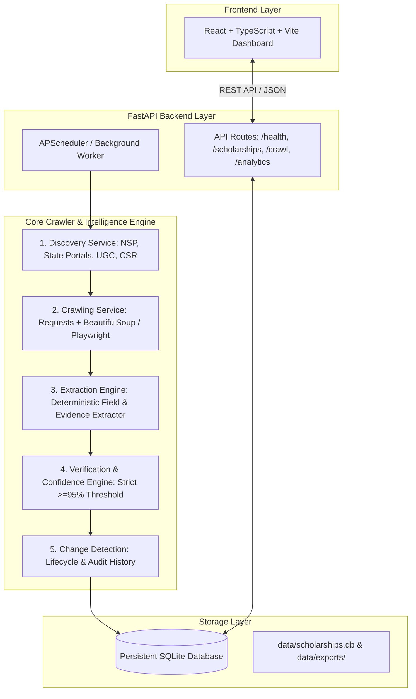

# System Architecture — Scholarship Intelligence Crawler for Indian Students

## 1. System Overview

The **Scholarship Intelligence Crawler** is an automated, reliable system designed to discover, crawl, extract, verify, and track the lifecycle of authentic scholarship opportunities for Indian students across government, state, university, corporate CSR, and philanthropic trust portals.



---

## 2. Component Directory Architecture

```
scholarship-intelligence-crawler/
├── .env.example                     # Documented configuration template
├── .gitignore                       # Git exclusion rules
├── README.md                        # Quickstart & Windows PowerShell guide
├── data/                            # Persistent SQLite database & exports
│   └── .gitkeep
├── docs/                            # Architecture and specification docs
│   └── architecture.md
├── frontend/                        # React + TypeScript + Vite dashboard
│   ├── src/
│   │   ├── App.tsx                  # Dashboard interface & health monitor
│   │   ├── App.css                  # UI styling
│   │   └── main.tsx
│   ├── package.json
│   └── vite.config.ts
└── backend/                         # FastAPI application
    ├── requirements.txt             # Python dependencies
    ├── pyproject.toml               # Pytest & package settings
    ├── app/
    │   ├── main.py                  # FastAPI application entrypoint
    │   ├── core/
    │   │   ├── config.py            # Pydantic BaseSettings & env resolution
    │   │   └── __init__.py
    │   ├── db/
    │   │   ├── database.py          # SQLAlchemy engine & session factory
    │   │   ├── init_db.py           # DB initialization & system schema
    │   │   └── __init__.py
    │   ├── api/
    │   │   ├── routes/
    │   │   │   ├── health.py        # GET /api/health
    │   │   │   └── __init__.py
    │   │   └── __init__.py
    │   ├── models/
    │   │   ├── schemas.py           # Pydantic schemas
    │   │   └── __init__.py
    │   └── services/
    │       ├── discovery/           # Discovery candidate feeds
    │       ├── crawling/            # HTTP client, headers & delays
    │       ├── extraction/          # Deterministic field extraction
    │       ├── verification/        # Evidence validation & confidence scoring
    │       └── change_detection/    # Diffs, audit trail & status changes
    └── tests/
        ├── test_health.py           # Health endpoint tests
        └── test_db.py               # Database connectivity & CRUD tests
```

---

## 3. Data Flow & Service Responsibilities

### 1. Discovery Service (`backend/app/services/discovery`)
- Curates authentic source seeds:
  - **Government**: National Scholarship Portal (NSP), AICTE, UGC, state-level portals (e.g., SSP Karnataka, MahaDBT, Oasis WB).
  - **Corporate CSR**: Reliance Foundation, Tata Trusts, HDFC Badhte Kadam, ONGC, Infosys Foundation.
  - **University / Institute**: Central and premier state university scholarship programs.
- Implements seed scheduling and URL deduplication.

### 2. Crawling Service (`backend/app/services/crawling`)
- Performs ethical, respectful HTTP fetching via `requests` and `beautifulsoup4`.
- Incorporates user-agent disclosure, retry with exponential backoff, rate limiting (2-second default interval), and robots.txt checks.
- Leaves headless Playwright available strictly for modern JS-rendered single-page applications.

### 3. Extraction Engine (`backend/app/services/extraction`)
- Deterministically parses fields:
  - Scholarship Name / Title
  - Provider Name & Category (Government / CSR / University / Foundation)
  - Eligibility Criteria (Education level, Gender, Annual Family Income, Caste/Category, Minimum Marks)
  - Financial Award & Benefits
  - Application Deadline & Cycle
  - Official Application URL
  - **Evidence Text**: Verbatim textual snippets extracted from the page to support each field.

### 4. Verification & Confidence Engine (`backend/app/services/verification`)
- Calculates explainable confidence scores using deterministic scoring rules:
  - **Domain Legitimacy**: Official `.gov.in`, `.nic.in`, `.ac.in`, `.edu`, or registered corporate CSR domains (+40 pts).
  - **Field Completeness**: Title, provider, deadline, eligibility, award amount present (+30 pts).
  - **Evidence Provenance**: Direct textual match in source HTML (+20 pts).
  - **Deadlines**: Valid, unexpired future date (+10 pts).
- **Strict Verification Rule**: A record is only tagged `VERIFIED` when confidence score is **≥ 95%** AND all mandatory fields are corroborated with evidence.

### 5. Change Detection Service (`backend/app/services/change_detection`)
- Detects field-level mutations between crawls (e.g., deadline extended, stipend increased).
- Records historical versions in an audit trail table without overwriting past entries.
- Tags records as `ACTIVE`, `STALE` (no update observed for 30+ days), or `EXPIRED` (deadline passed).

---

## 4. Phased Implementation Roadmap

- **Phase 1 (Completed)**: Project foundation, Python venv, FastAPI backend, SQLite database connectivity, React/Vite/TS dashboard, configuration management, `.env.example`, `.gitignore`, test suites, and documentation.
- **Phase 2 (Planned)**: Authentic source seed catalogue, Discovery service, and polite Crawling service for Indian student scholarship sources.
- **Phase 3 (Planned)**: Deterministic scholarship field extraction with verbatim evidence capture.
- **Phase 4 (Planned)**: Explainable confidence scoring engine and strict ≥95% verification logic.
- **Phase 5 (Planned)**: Historical change detection, lifecycle status transitions, full dashboard UI, and comprehensive verification benchmarks.
