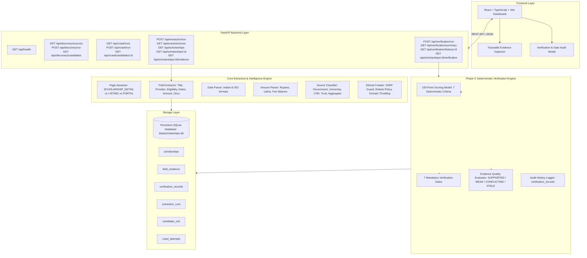

# System Architecture — Scholarship Intelligence Crawler for Indian Students

## 1. System Overview

The **Scholarship Intelligence Crawler** is an automated, reliable system designed to discover, crawl, extract, verify, and track the lifecycle of authentic scholarship opportunities for Indian students across government, state, university, corporate CSR, and philanthropic trust portals.

---

## 2. Phase 4: Deterministic Confidence Engine & Verification

### A. Core Verification Principles
1. **Zero Hallucination Scoring**: The engine never uses LLMs or probabilistic heuristics to invent confidence numbers. Scores are 100% deterministic and reproducible from stored evidence.
2. **Strict Verification Threshold**: A scholarship can be marked `VERIFIED` **only** when:
   - Its computed score is $\ge 95.0\%$.
   - **All 7 mandatory verification gates pass**.
   - Official primary source is adequately established.
   - Critical fields are supported by verified evidence.
   - No unresolved critical contradiction exists.
3. **Gate Dominance**: A score of $\ge 95\%$ alone **never overrides a failed verification gate**. Any failed gate immediately forces `REVIEW_REQUIRED`.

### B. 100-Point Deterministic Allocation Formula

| Criterion | Max Points | Evaluation Rules |
| :--- | :---: | :--- |
| **Official Primary Source Established** | 25 | Government apex (.gov.in/.nic.in) = 25 pts; University (.ac.in/.edu.in) = 23 pts; Corporate CSR / Trust = 20 pts; Aggregator = 0 pts (-25 pts deduction). |
| **Scholarship-Specific Identity & Presence** | 20 | Distinct opportunity name = 20 pts; umbrella/multi-scheme portal title = 5 pts (-15 pts deduction); absent provider = -5 pts. |
| **Critical Fields Supported by Evidence** | 20 | 5 pts each for Name, Provider, Eligibility Criteria, and Benefit/Course Level. Weak container snippets penalized by 50%. |
| **Application URL Verified** | 10 | Official portal link = 10 pts; legitimately absent/closed (`NOT_APPLICABLE`) = 10 pts; third-party/untrusted domain = 3 pts; missing when required = 0 pts. |
| **Deadline Supported by Contextual Evidence** | 10 | Explicit deadline keyword context = 10 pts; generic date = 4 pts; expired deadline = 0 pts (-10 pts deduction); rolling/ongoing = 6 pts. |
| **Source Freshness & Successful Fetch** | 10 | HTTP 200 within 14 days = 10 pts; within 60 days = 7 pts; aged (>120 days) = 1 pt; HTTP error = 0 pts. |
| **Extraction Consistency & Contradictions** | 5 | Clean internal consistency = 5 pts; conflicting dates, multiple deadlines, or conflated multi-schemes = 0 pts. |

### C. 7 Mandatory Verification Gates
1. `official_source_gate`: Validates official primary domain classification; fails for aggregators.
2. `scholarship_identity_gate`: Validates specific singular grant opportunity; fails for directory/umbrella titles.
3. `field_evidence_gate`: Requires direct `SUPPORTED` evidence for critical fields; fails on generic body dumps.
4. `contradiction_gate`: Validates absence of conflicting dates, benefits, or multi-scheme conflations.
5. `freshness_gate`: Confirms HTTP 200 success and fetch age $\le 90$ days.
6. `application_link_gate`: Validates official application domain or enforces `NOT_APPLICABLE` rule.
7. `lifecycle_gate`: Validates deadline against evaluation date; fails immediately if closing date is expired.

---

## 3. Database Schema

- `scholarships`: Includes `verification_status` (`UNVERIFIED`, `VERIFIED`, `REVIEW_REQUIRED`, `NO_LONGER_VERIFIABLE`) and `confidence_score`.
- `field_evidence`: Includes `quality_rating` (`SUPPORTED`, `WEAK_EVIDENCE`, `NOT_FOUND`, `CONFLICTING`, `STALE`).
- `verification_records`: Complete audit history of each verification evaluation (`confidence_score`, `verification_status`, `lifecycle_status`, `scoring_breakdown`, `gate_results`, `deductions_reasons`, `evidence_references`, `is_latest`, `verified_at`).
- `extraction_runs`, `candidate_urls`, `crawl_attempts`, `seed_sources`.

---

## 4. Phased Implementation Roadmap

- **Phase 1: Project Foundation** — COMPLETED (FastAPI, SQLite, basic models, health checks).
- **Phase 2: Authentic Crawling & Discovery** — COMPLETED (SSRF guard, robots.txt, domain throttles, candidate discovery).
- **Phase 3: Deterministic Extraction & Verbatim Evidence** — COMPLETED (Page assessor, field extractor, date/amount parsers, field_evidence table).
- **Phase 4: Deterministic Confidence Engine & Verification** — COMPLETED (100-pt scoring model, 7 mandatory gates, audit history, React verification dashboard).
- **Phase 5: Change Detection & Alerting Engine** — NEXT PHASE (Content diff tracking, notification triggers, lifecycle progression).
